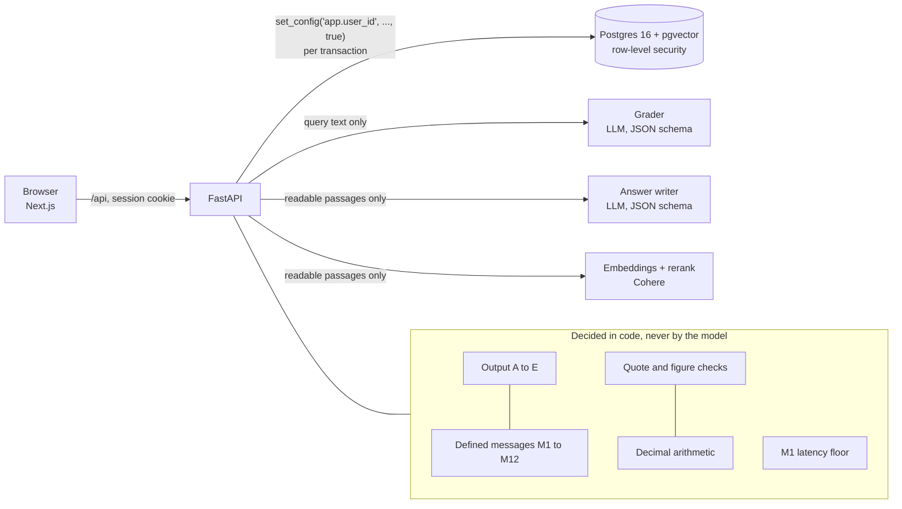

# Design

This document explains how the proof of concept meets the SRS clauses that carry the most
risk, and what each decision costs. Clause numbers refer to the Linearyze EMS SRS v1.

## 1. Request path

Two facts drive the layout:

- **The grader sees only the query** (1.3.7). It cannot be steered by a document, because it
  never reads one.
- **Everything the writer and the reranker see has already passed row-level security.**
  Unreadable text never leaves Postgres, so there is nothing for a prompt to leak.

## 2. Permissions in the database (0.10.1, 1.3.2, 0.9.2.2)

The API logs in as `ems_app`, a role with `NOBYPASSRLS` that owns no table. Each request
runs in one transaction that starts with `set_config('app.user_id', <uuid>, true)`; the
`true` makes it transaction-local, so a pooled connection cannot carry one user's identity
into the next request. One SQL function, `can_read_document`, decides readability; the
policies on `chunks` and `document_files` defer to the policy on `documents` through an
`EXISTS` subquery, so a passage, its vector and its file are visible exactly when the
document is.

Consequences:

- Full-text search, vector search, metadata lookups, View and Download are all filtered
  inside SQL, before ranking. An Employee's search space simply does not contain the
  confidential memo or the other event's contract.
- Role and scope are read from the database on every request (no claims cached in a
  token), so a scope change applies to the next request (0.7.8; tested).
- The audit log's excluded-document count (1.12.2) comes from a `SECURITY DEFINER`
  function that returns a bare integer and nothing else.

Trade-off: the SQL is more involved than filtering in Python, and every query pays for the
policy check. In return, leakage is prevented by construction rather than by remembering a
filter in each code path.

## 3. The permission matrix as data (0.8, 0.8.22, 0.8.23)

`api/app/auth/permission_matrix.yaml` is the SRS 0.8 table, cell for cell, keyed by clause
(`"0.8.1"` ... `"0.8.21"`). Routes declare the capability they need with
`require("0.8.2")`. TBD cells stay TBD and are denied, unless `poc_decisions` records a
choice; a decision may only settle a TBD cell, never overrule a Y or N (enforced at load).
The PoC opens 0.8.2 to Employees so the demo can show the Advisor using only figures from
documents in the Employee's scope. Every cell is tested (63 cases).

## 4. One M1 (1.5.4, 0.10.2, 0.10.3)

The four causes of "not found" (no such document, no access, below the relevance
threshold, not yet indexed) all end in `render_message("M1", lang)`, which builds the body
from the message constant alone. Nothing about the request can reach it: the debug flag
adds nothing to an M1 (tested).

Timing is the subtle part. The causes take different amounts of work, so the HTTP layer
holds every M1 until `M1_LATENCY_FLOOR_S` after the request arrived. The floor must sit
above the slowest path that can end in M1, which is an answer that is drafted, fails
validation, is regenerated and fails again. Measured paths took up to 9.3 s on Claude and
12.7 s on the fallback model, so the floor is 20 s. A production deployment would set it from
the measured p99 of that path; `docs/EVAL_REPORT.md` reports the measured spread.

## 5. Grading and output selection (1.6, 1.7)

The model proposes grade scores and filters as JSON validated against a Pydantic schema.
Code makes the decisions: two requests or a score gap under 0.15 is AM; a payment request
is OT; the output type follows a fixed table (`assistant/outputs.py`). Defined messages and
M8 are constants (`assistant/messages.py`), transcribed from the SRS and tested against a
fixture.

### The Ministry example (1.14.9)

"The letter from Ministry A that we received on the day we submitted document X" is a
two-step plan, not a similarity search: find X by title and read its `submitted_date`,
then filter incoming letters from the resolved organisation on that date. Organisation
names resolve through normalized aliases (`org_aliases`), so "Ministry A", "the Ministry of
Exhibitions and Heritage" and "وزارة المعارض والتراث" all land on one id. The corpus has
four letters from that ministry on different days and another authority's letter on the
target day, so a plan that ignored the date or the sender would return the wrong letter.

## 6. Retrieval (1.5.2, 1.6.4, 1.6.5)

- Full-text (`tsvector` over normalized, lightly stemmed terms) and vector (pgvector,
  cosine, HNSW) candidates, 50 each, under RLS.
- Reciprocal rank fusion (k = 60), then the top 20 passages are reranked.
- The reranker scores the grader's English topic ("payment terms"), not the full question.
  A short topic scored 0.59 where the full question scored 0.23, because the organisation
  name in the question is not in the passage. Every passage is reranked together with both
  of its document's titles (English and Arabic) and its section heading, which is what
  lets an Arabic question find an English contract.
- Passages under the threshold are dropped. Handing over a whole document (Output A or D)
  from passage search alone needs a stronger score than using a passage in an answer.

## 7. Grounded answers (1.8.2.9 to 1.8.2.16)

The writer returns sentences, each with quotes that name a passage. Code then:

1. finds each quote in its passage, exactly or after normalization, and displays the
   original slice, never the model's string (`find_original_span` keeps an offset map from
   normalized to original text);
2. requires every number, date and proper name in the sentence to appear in that
   sentence's own quotes (a sentence may name the document it cites);
3. regenerates once with the list of errors, then drops any sentence that still fails;
   nothing left means M1.

Conflicts are found from the quotes: the model names each fact and copies its value, code
parses and compares the values across different documents (not versions). M7 comes first,
each value is shown with its own quote, and sentences that pick a side are removed.

## 8. Arabic (1.4)

`app/text/arabic.py` is the single normalizer: diacritics and tatweel removed, Arabic-Indic
and Eastern digits mapped to ASCII, hamza and alef forms, ta marbuta and alef maqsura
unified, NFKC. It is applied to indexed text, aliases, titles and every query, never to
the stored original.

PDF extraction needed real work. A PDF stores right-to-left lines partly in visual order,
and number runs inside Arabic come out reversed ("٦٢٠٢" for "٢٠٢٦"). The parser rebuilds
each Arabic line from glyph positions and reorders it with the Unicode bidi algorithm,
which recovers reading order including digits (`ingest/parsers.py`, tested). PDFs whose
text layer maps lam-alef ligatures to the reversed pair still need a fix; the SRS PDF itself
is one, and its Arabic messages were corrected by hand.

## 9. The Advisor without a formula library (2.1.3, 2.6 to 2.9)

1. The user's formula ("break-even booths = (total cost − confirmed revenue) / standard
   booth price", or "ربح = إيرادات ناقص تكاليف") is extracted from the query by code.
   Operator words in either language become symbols; every other run of words is a term.
2. A small recursive-descent parser accepts numbers, names, `+ - * / ( ) %` and nothing
   else. The tree keeps the user's brackets, so the formula line shown is the user's own
   text, never a simplified one. Malformed input returns Q naming the part to fix.
3. Each term is bound to a user value, a value from an earlier message, or a document
   quote. For a document value the model only points at a passage and copies the quote;
   code checks the quote is in the passage, checks the figure is in the quote, and parses
   the number itself. The model never supplies a number that is used in arithmetic.
4. Evaluation is `decimal.Decimal` at 50 digits with units attached, so
   (SAR − SAR) / (SAR per booth) comes out in booths, SAR + USD is refused (Q), and only
   the final result is rounded. Booth counts round up with a note.

A test fails the build if a business formula (`break_even =`, `margin =`, `profit =` and
similar) ever appears in `app/advisor/`.

## 10. Model providers

All model calls go through `app/llm.py` with a structured-output schema. The production
model is Claude: Sonnet 5.5 with thinking off for grading and extraction (on the M1 latency
path), Opus 5.5 for writing Output B. Providers are tried in order (`LLM_PROVIDERS`,
default `anthropic,gemini,cohere`), and a provider that fails sits out two minutes so an
outage costs one slow request. Gemini 3.5 Flash and Cohere Command A are wired in as
fallbacks only. Schemas are sent in strict form (references inlined, every field required) so
the same Pydantic models work on every provider. Without keys, deterministic offline
stand-ins run instead; the test suite and CI use them, so they need no network and give the
same answer every time. The offline stand-ins are not a quality measure, and the evaluation
report states which providers produced it.

## 11. What the PoC does not do yet

See "Designed, not built" in the README. The main gaps are memory (1.10), OCR (1.2.3),
per-day limits (1.3.10), the third-regrade rules (1.8.3.8, 2.8.12), and a rate limit that
works across several serverless instances.
